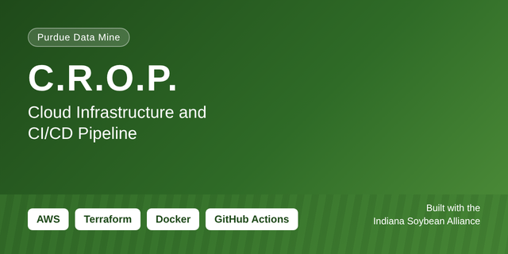

# C.R.O.P. Conservation and Revenue Opportunity Portal

Indiana Soybean Alliance | Purdue Data Mine

> **Note:** This is not the full project. This repo only shows my own work and findings as the DevOps and cloud engineer on the team. The project's source code, data, and credentials belong to Purdue's Data Mine and the Indiana Soybean Alliance, and they are private and not included here.

An interactive web platform that gathers agricultural conservation and incentive programs from sources such as the USDA and NRCS and shows them to farmers based on where their fields are. It makes it easier for farmers to find and use sustainable growing programs by putting them in one place. Presented at the 2026 Corporate Partners Symposium.

This repo documents my contribution as the DevOps and cloud engineer on a team of 8, from July 2025 to June 2026.

## The problem
Farmers have many programs available for adopting sustainable growing practices, but the programs are complex and spread across many sources, so they often go unused. CROP brings them together and presents them geographically.

## What the platform does (team work)
* Interactive map for searching programs by location
* Attribute based filtering to find programs that fit specific criteria
* Program recommendations based on a farmer's field data and soil type
* Field management: farmers upload field boundaries as shapefiles and track crop history, cover crops, and inputs
* Admin dashboard where the Indiana Soybean Alliance manages program listings and scrape URLs
* Roadmap: an AI chatbot to guide farmers through the application process

## System overview
* React and Vite frontend
* Node.js and Express REST API
* Python and FastAPI services for web scraping and SSURGO soil data
* Selenium for pages that need a real browser
* Job queue between the API and the scraping service (AWS SQS, with ElasticMQ for local development)
* PostgreSQL database
* OpenAI API for extracting program data and explaining recommendations
* Docker and Docker Compose for containers
* AWS and Terraform for production infrastructure

## CI/CD pipeline
The original Fall 2025 pipeline design is below. It deployed to EKS. The team later moved to ECS Fargate, so the deploy stage now targets ECS instead.

## My role
* Built and maintained AWS infrastructure as code with Terraform
* Set up the GitHub Actions CI/CD pipeline, including environment promotion, secret management, linting and unit tests, and database migrations
* Contributed to backend development: built APIs and implemented authentication
* Wrote the documentation and handoff materials for the next team

## Infrastructure
* Containers run on AWS ECS Fargate, with images stored in ECR
* Frontend hosted on S3 and CloudFront
* PostgreSQL on Amazon RDS
* AWS Secrets Manager for credentials
* Three separate environments with their own configuration

## Decisions I worked on
* Moved from EKS to ECS Fargate to reduce operational overhead for a small team
* Replaced a NAT Gateway with VPC interface endpoints to lower cost

## Documentation in this repo
* [Deployment notes](docs/deployment-notes.md): how the frontend and backend were containerized and shipped through CI/CD
* [Git workflow](docs/git-workflow.md): the branch and pull request process our team followed

## Skills shown
AWS (ECS Fargate, RDS, ECR, Secrets Manager), Terraform, Docker, CI/CD, GitHub Actions, Python, SQL, API development, authentication, technical documentation

## Notes
This repo contains no keys, passwords, state files, account IDs, or partner data.

Connect with me on LinkedIn: https://www.linkedin.com/in/ethan-perdieu-1438271b8
